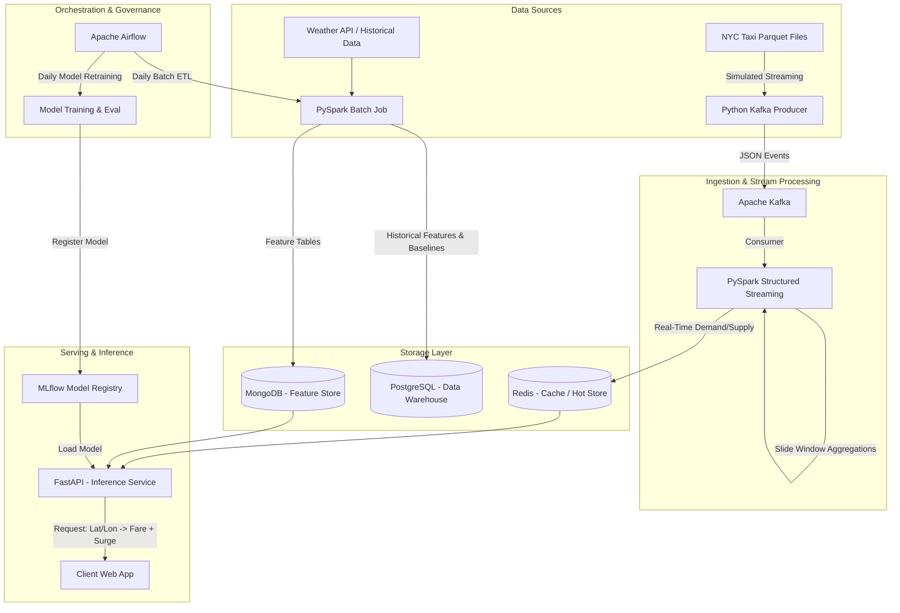

# Đề xuất Dự án: Hệ thống Dự báo Nhu cầu & Tính giá Động Thời gian thực (Real-Time Trip Demand & Dynamic Pricing Engine)

Ý tưởng này nâng cấp dự án phân tích dữ liệu NYC Taxi truyền thống thành một hệ thống Lambda/Kappa Architecture hoàn chỉnh, phục vụ bài toán tối ưu hóa vận hành thực tế của các hãng gọi xe (như Grab, Uber).

---

## 1. Bài toán Nghiệp vụ (Business Problem)

Các ứng dụng gọi xe cần dự báo nhu cầu đặt xe (demand) và số lượng xe trống (supply) tại từng khu vực trong thời gian thực. Khi nhu cầu vượt quá nguồn cung, hệ thống cần tự động tính toán hệ số nhân giá động (surge multiplier) để cân bằng cung-cầu và tối ưu hóa doanh thu, đồng thời gợi ý tài xế di chuyển đến các khu vực "nóng".

---

## 2. Kiến trúc Hệ thống (Architecture)

---

## 3. Các thành phần chính và giải pháp kỹ thuật

### 3.1. Giả lập luồng dữ liệu thời gian thực (Real-time Simulation)

- Do dữ liệu NYC Taxi là dữ liệu lịch sử dưới dạng file Parquet, chúng ta sẽ xây dựng một **Python Kafka Producer** để đọc dữ liệu Parquet theo thứ tự thời gian (`tpep_pickup_datetime`) và gửi các record này dưới dạng JSON event lên Kafka topic `nyc-taxi-trips` để mô phỏng dữ liệu thời gian thực đang phát sinh.

### 3.2. Xử lý không gian (Spatial Indexing) bằng H3 Grid

- Để tính toán cung-cầu theo khu vực, ta không thể sử dụng tọa độ Latitude/Longitude thô. Hệ thống sẽ sử dụng thư viện **H3 (Uber's Hexagonal Hierarchical Spatial Index)** để phân vùng bản đồ thành các ô lục giác (ví dụ: độ phân giải Resolution 7 hoặc 8).
- Mỗi chuyến đi có tọa độ pickup sẽ được ánh xạ thành một `h3_index` duy nhất (ví dụ: `882a100d2bfffff`).

### 3.3. Xử lý luồng thời gian thực (Stream Processing)

- **PySpark Structured Streaming** (hoặc Flink) đọc dữ liệu từ Kafka.
- Sử dụng **Sliding Windows** (ví dụ: 10 phút, slide mỗi 1 phút) để tính toán:
  - **Demand**: Số lượng yêu cầu đặt xe (hoặc số chuyến đi bắt đầu) tại mỗi ô lục giác `h3_index`.
  - **Supply**: Số lượng xe trống dự kiến (dựa trên số lượng chuyến đi kết thúc - dropoff) tại mỗi ô `h3_index`.
- Kết quả tổng hợp thời gian thực được ghi trực tiếp vào **Redis** dưới dạng các cặp Key-Value có TTL (Time-To-Live) để tự động xóa dữ liệu cũ.

### 3.4. Hệ thống ML & API Tính giá động (Serving Layer)

- Xây dựng một **FastAPI** service.
- Khi khách hàng yêu cầu đặt xe:
  1. Client gửi yêu cầu kèm tọa độ đón `(lat, lon)`.
  2. FastAPI chuyển đổi `(lat, lon)` thành `h3_index`.
  3. FastAPI truy vấn **Redis** để lấy số liệu Demand/Supply hiện tại của khu vực đó.
  4. FastAPI truy vấn **MongoDB** (Feature Store) để lấy các đặc trưng lịch sử của khu vực này tại khung giờ hiện tại (ví dụ: giá cơ bản, lịch sử tắc đường).
  5. FastAPI đưa các đặc trưng này vào mô hình Machine Learning (được huấn luyện trước và quản lý bởi MLflow) để dự đoán fare amount và hệ số nhân giá động (surge multiplier).

### 3.5. Biến đổi dữ liệu Batch & Điều phối (Batch Layer)

- **Airflow** chạy các DAG hàng ngày:
  - Chuyển đổi dữ liệu thô tích lũy từ GCS sang PostgreSQL phục vụ phân tích BI.
  - Tính toán lại các đặc trưng lịch sử (Historical Baselines) và lưu trữ vào MongoDB.
  - Retrain mô hình Machine Learning định kỳ dựa trên dữ liệu mới nhất.
